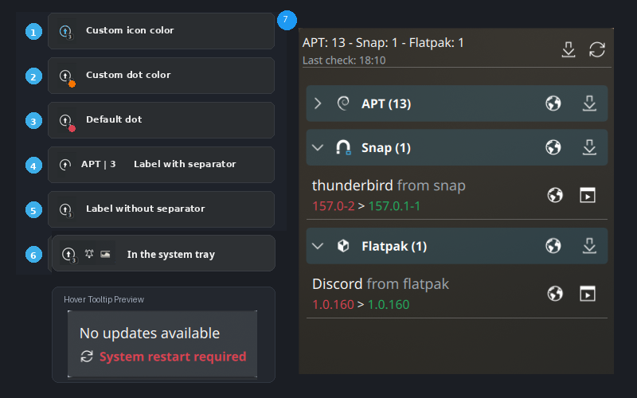

# APT Update Counter - KDE Plasma 6 Widget

   

A KDE Plasma 6 panel widget and system tray applet for monitoring and applying **APT**, **Snap**, and **Flatpak** updates on Kubuntu, Ubuntu, and Debian systems. Derived with gratitude from [bouteillerAlan/archupdate](https://github.com/bouteillerAlan/archupdate).



1 - Custom icon color | 2 - Custom dot color | 3 - Default dot | 4 - Label with separator | 5 - Label without separator | 6 - In the system tray | 7 - Package list popup

---

## Features

- **Multi-Ecosystem Tracking (APT, Snap & Flatpak):** Monitors APT packages alongside Snap and Flatpak applications, with independent toggles to disable unneeded backends and eliminate idle checks.
- **Ubuntu & Debian Distribution Awareness:** Reads `/etc/os-release` to route APT package info links to `packages.ubuntu.com` or `packages.debian.org` and hides Ubuntu-only `do-release-upgrade` banners on Debian.
- **Phased Updates Control:** Filters out deferred Ubuntu phased updates by default or optionally includes them via `-o APT::Get::Always-Include-Phased-Updates=true`.
- **Safe Silent Background Updates (`pkexec`) & Terminal Upgrades (`konsole`):** Runs non-interactive `apt-get` upgrades cleanly (`--force-confdef`, `--force-confold`, closed stdin) under `systemd-inhibit` and isolated user scopes, or launches interactive upgrades in Konsole (optionally with `nala`).
- **Package Manager Lock & Connectivity Resilience:** Detects active `dpkg`, `apt`, and `org.freedesktop.PackageKit` D-Bus transactions cleanly without false positives on idle `packagekitd`, warns when local `/var/lib/apt/lists` metadata becomes stale, and preserves cached updates while offline.
- **Clear Error & Status Visibility:** Displays negative theme error indicators on both badge and dot modes, surfaces diagnostic summaries in tooltips, and isolates partial repository errors without hiding healthy package lists.
- **Reboot & Desktop Notifications:** Detects `/var/run/reboot-required`, prompts through KDE's Session D-Bus (`org.kde.LogoutPrompt`), and delivers origin-aware security update notifications with configurable thresholds.
- **Clean XDG Storage:** Stores volatile update cache (`cache.json`) and capped debug logs (`debug.log`) in `$XDG_CACHE_HOME/hadbilen.aptupdate.plasmoid/` and transient failure/exit/process-group logs in `$XDG_RUNTIME_DIR/aptupdate` (falling back to `$XDG_CACHE_HOME/hadbilen.aptupdate.plasmoid/logs`) with private `0700`/`0600` permissions rather than polluting KDE configuration files.

---

## How Update Checking Works (Explanation)

### Coexistence with KDE Discover Notifier & `apt-daily.timer`

Passive update checks run unprivileged without invoking `sudo apt update`. Because `/var/lib/apt/lists` requires root privileges to refresh, the widget relies on your distribution's scheduled `apt-daily.timer` (or KDE Discover / manual upgrades) to keep local APT package indexes fresh:

- When you run a full upgrade from the widget, it runs `apt-get -o DPkg::Lock::Timeout=10 update` before upgrading packages.
- If `/var/lib/apt/lists` has not been updated for more than 3 days, the popup displays an informational notice reminding you that local APT package metadata is stale.
- Because the widget probes `org.freedesktop.PackageKit` over D-Bus in addition to `dpkg` frontend locks, running upgrades concurrently with KDE Discover safely disables APT install triggers until Discover finishes.

### Nala `--no-autoremove` & `--with-new-pkgs` Behavior

When **Use Nala for APT upgrades (terminal mode only)** is enabled, interactive full upgrades invoke `sudo nala upgrade --no-autoremove -o DPkg::Lock::Timeout=10` and single-package installs invoke `sudo nala install --no-autoremove -o DPkg::Lock::Timeout=10 -y`. Silent background upgrades (`pkexec`) and passive update checks always remain on deterministic `apt-get` (`apt-get -s --with-new-pkgs upgrade`) so count and list parsing match reliably across releases; because `nala upgrade` may defer upgrades requiring brand-new dependency packages compared to `apt-get --with-new-pkgs`, the number of packages upgraded by Nala can occasionally be lower than the listed count.

---

## Installation & Upgrade (How-To)

### 1. Prerequisites

Install the required runtime packages for Kubuntu, Ubuntu, or Debian (most are pre-installed on KDE Plasma desktops):

```bash
sudo apt install konsole pkexec psmisc procps iproute2 systemd libglib2.0-bin dbus-bin libnotify-bin gawk
```

Optional integrations supported when installed: `nala`, `snapd`, `flatpak`, `network-manager` (`nmcli`), `qdbus-qt6`, `kdialog`, and `ubuntu-release-upgrader-core`.

### 2. Install via `kpackagetool6` (Recommended)

Package a clean release archive and install or upgrade using KDE's package manager:

```bash
# Clone the repository
git clone https://github.com/hadbilen/aptupdate.git /tmp/aptupdate
cd /tmp/aptupdate

# Build and verify the clean .plasmoid archive under dist/
./scripts/package.sh

# Install (first time) or upgrade (existing installation)
kpackagetool6 --type Plasma/Applet --install dist/hadbilen.aptupdate.plasmoid-v1.2.2.plasmoid
# To upgrade an existing install instead:
# kpackagetool6 --type Plasma/Applet --upgrade dist/hadbilen.aptupdate.plasmoid-v1.2.2.plasmoid

# Restart Plasmashell to reload QML/service components
systemctl --user restart plasma-plasmashell.service
```

To verify installation or uninstall later:

```bash
kpackagetool6 --type Plasma/Applet --show hadbilen.aptupdate.plasmoid
kpackagetool6 --type Plasma/Applet --remove hadbilen.aptupdate.plasmoid
```

### 3. Direct User Directory Install

If you prefer copying the widget directory directly from a source checkout:

```bash
mkdir -p ~/.local/share/plasma/plasmoids
cp -a hadbilen.aptupdate.plasmoid ~/.local/share/plasma/plasmoids/
kbuildsycoca6 --noincremental
systemctl --user restart plasma-plasmashell.service
```

### 4. Add to Panel or System Tray

1. **On a Panel:** Right-click the panel, choose **Add Widgets...**, search for **APT Update Counter**, and drag it into place.
2. **In the System Tray:** Right-click the System Tray arrow, select **Configure System Tray...** -> **Entries**, and set **APT Update Counter** to *Shown when relevant* or *Always shown*.

---

## Default Configuration & Commands (Reference)

Defaults defined in `contents/config/main.xml` and generated by `contents/service/CommandBuilder.js`:

| Setting / Operation | Default Value or Command | Notes |
| :--- | :--- | :--- |
| **Enable Snap Updates** | `true` | Disabled automatically if `snap` is absent |
| **Enable Flatpak Updates** | `true` | Disabled automatically if `flatpak` is absent |
| **Include Phased Updates** | `false` | Appends `-o APT::Get::Always-Include-Phased-Updates=true` |
| **Silent Background Updates** | `false` | Executes via `pkexec` under `systemd-inhibit` and `< /dev/null` |
| **Use Nala (Terminal Only)** | `false` | Uses `sudo nala upgrade --no-autoremove -o DPkg::Lock::Timeout=10` when installed |
| **APT Count / List (internal)** | `LC_ALL=C apt-get -s --with-new-pkgs -o DPkg::Lock::Timeout=10 upgrade` | Read-only pipeline with `set -o pipefail` |
| **Snap / Flatpak Check (internal)** | `snap refresh --list` / `flatpak remote-ls --updates` | Single-pass `timeout --kill-after=5s 20s` queries; Flatpak tracks `<appId>//<branch>` |
| **Full Upgrade (Terminal)** | `sudo apt -o DPkg::Lock::Timeout=10 update && sudo apt -o DPkg::Lock::Timeout=10 upgrade` | Appends `sudo snap refresh` and `flatpak update -y` for active pending backends |
| **Full Upgrade (Silent `pkexec`)** | `apt-get -o DPkg::Lock::Timeout=10 update && apt-get -o DPkg::Lock::Timeout=10 -o Dpkg::Options::=--force-confdef -o Dpkg::Options::=--force-confold upgrade -yq --with-new-pkgs` | Sets `DEBIAN_FRONTEND=noninteractive`, `APT_LISTCHANGES_FRONTEND=none`, `NEEDRESTART_MODE=a` |
| **Update One Package Command** | `sudo apt install --only-upgrade` | Injects `-o DPkg::Lock::Timeout=10 -y -- <pkg>` (or routes Snap/Flatpak directly) |
| **Terminal Command** | `konsole -e bash -c` | Configurable terminal launcher |
| **Cache & Debug Log Directory** | `$XDG_CACHE_HOME/hadbilen.aptupdate.plasmoid/` | Stores `cache.json` and capped 200-line `debug.log` (migrated out of KConfig) |
| **Transient Runtime Log Directory** | `$XDG_RUNTIME_DIR/aptupdate` (fallback: `$XDG_CACHE_HOME/hadbilen.aptupdate.plasmoid/logs`) | Stores `0700` per-run failure, exit-code (`rc`), and process-group (`pgid`) logs |

---

## Development, Testing & Translations

### Run Automated Checks

Requires Qt 6 (`qmllint`, `qmltestrunner`), `xmllint`, `msgfmt`, and `zip`:

```bash
QT_QPA_PLATFORM=offscreen /usr/lib/qt6/bin/qmltestrunner -import tests/mocks -input tests/tst_ac1_ac4_seams.qml
./tests/mocks_exec/build.sh
QT_QPA_PLATFORM=offscreen /usr/lib/qt6/bin/qmltestrunner -import tests/mocks -import tests/mocks_exec -input tests/tst_main_state_seams.qml
bash tests/test_shell_seams.sh
./scripts/package.sh
```

> **Upgrade / Rollback Note (`<= v1.2.1 <-> v1.2.2`):** Deprecated KConfig keys (`cached*`, `debugLog`) inside `plasma-org.kde.plasma.desktop-appletsrc` are no longer written or read. Cached counts reset cleanly until the next check runs.

### Update Translations

Translations use GNU Gettext under `translate/`:

```bash
./translate/build.sh
msgfmt --check --statistics -o /dev/null translate/tr.po
```

To add a language, copy `translate/template.pot` to `translate/<lang>.po`, translate the entries, and run `./translate/build.sh` to compile `contents/locale/<lang>/LC_MESSAGES/plasma_applet_hadbilen.aptupdate.plasmoid.mo`.

---

## Credits & License

- **Original Creator & UI Design:** [Alan Bouteiller (A2N)](https://github.com/bouteillerAlan) ([bouteillerAlan/archupdate](https://github.com/bouteillerAlan/archupdate)).
- **Ubuntu / Debian / Snap / Flatpak Port & Maintainer:** [hadbilen](https://github.com/hadbilen) ([hadbilen/aptupdate](https://github.com/hadbilen/aptupdate)).
- **Trademarks:** Debian/APT, Canonical/Snapcraft, and Flatpak marks belong to their respective owners and are referenced strictly for identification.
- **License:** GNU General Public License v3.0 or later (`GPL-3.0+`). See [LICENSE](LICENSE).
